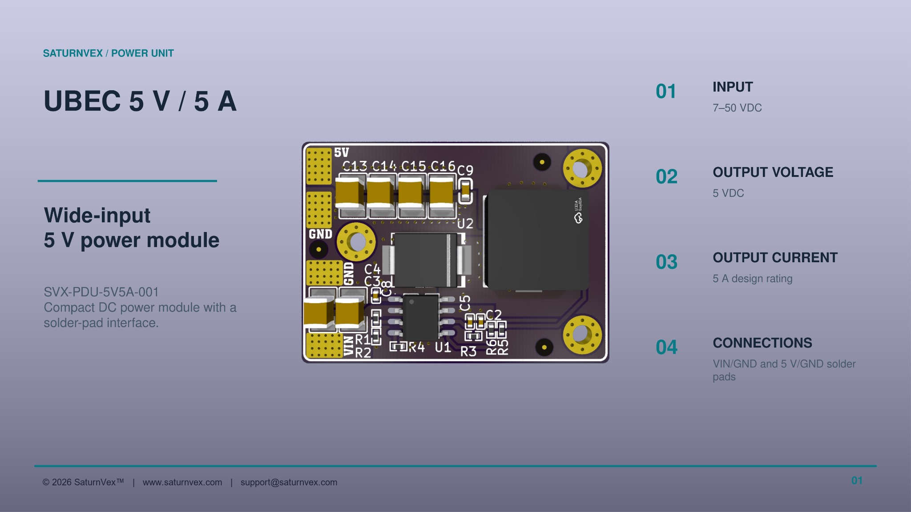
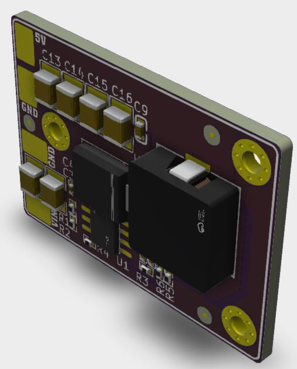

<strong>SATURNVEX · POWER UNIT</strong>

<!-- Full-width cover image; GitHub constrains content to the README panel width. -->

# SVX-PDU-5V5A — UBEC 5 V / 5 A

*SaturnVex™ — embedded hardware, firmware and Edge AI platforms*

A compact wide-input DC/DC power module (UBEC) that delivers a regulated 5 V supply at up to 5 A from a 7 – 50 VDC input. Input and output connections are made through solder pads, and three mounting holes allow the module to be fixed inside the end equipment.

This is a hardware-only product: there is no firmware or source code. The repository contains the electrical verification report, the original bench photographs and the mechanical CAD data.

## Product specifications

| Item | Specification |
|---|---|
| Product code | `SVX-PDU-5V5A-001` |
| Product category | UBEC / compact DC/DC power module |
| Input voltage | 7 – 50 VDC (design specification) |
| Nominal output voltage | 5 VDC |
| Output current | 5 A design rating |
| Measured efficiency at ≈ 5 A | 86.08 % (16.4 V in) · 84.52 % (28.8 V in) |
| Board dimensions | **35 × 25 mm (PCB, L × W)** |
| Connections | VIN / GND input solder pads; 5 V / GND output solder pads |
| Mounting | 3 plated mounting holes |
| Verification provided | Load test at 16.4 V and 28.8 V input, ≈ 1 – 6 A, with original bench photographs |

## Documentation

| Resource | File |
|---|---|
| **Product features & electrical verification report** | [Open PDF](docs/SaturnVex_SVX-PDU-5V5A-001_Test_Report_EN.pdf) |
| **Original bench test photographs (11)** | [Browse photos](assets/test-evidence/README.md) |
| **Test video (YouTube)** | [Line regulation test, 7 – 50 V at 5 A](https://youtu.be/In4UMFu_2-8) |
| **Mechanical CAD (35 × 25 mm)** | [CAD files / STEP](cad/README.md) |
| **Download all available documentation and CAD** | [Download complete package](downloads/SVX-PDU-5V5A-001_Complete_Resources.zip) |

## Test video

*Line regulation test with a passive heatsink: the input is swept from 7 to 50 V at a constant 5 A load and the output stays at about 4.98 – 4.99 V.*

## Electrical verification — measured results

Test equipment: SUNSHINE P-3005D DC power supply (input), JT6111 DC electronic load in constant-current mode (output), SIGLENT SDS 1202CNL oscilloscope (CH1 output waveform). Efficiency = Pout / Pin × 100 %.

| Vin (V) | Iin (A) | Pin (W) | Vout (V) | Iout (A) | Pout (W) | η (%) |
|---:|---:|---:|---:|---:|---:|---:|
| 16.4 | 0.67 | 10.99 | 5.14 | 1.994 | 10.25 | 93.28 |
| 16.4 | 1.03 | 16.89 | 5.11 | 2.993 | 15.29 | 90.54 |
| 16.4 | 1.41 | 23.12 | 5.09 | 3.993 | 20.32 | 87.89 |
| 16.4 | 1.79 | 29.36 | 5.06 | 4.994 | 25.27 | 86.08 |
| 16.4 | 2.21 | 36.24 | 5.04 | 5.993 | 30.20 | 83.34 |
| 28.8 | 0.18 | 5.18 | 5.19 | 0.993 | 5.15 | 99.41 |
| 28.8 | 0.39 | 11.23 | 5.15 | 1.993 | 10.26 | 91.38 |
| 28.8 | 0.81 | 23.33 | 5.10 | 3.993 | 20.36 | 87.30 |
| 28.8 | 1.04 | 29.95 | 5.07 | 4.993 | 25.31 | 84.52 |
| 28.8 | 1.27 | 36.58 | 5.05 | 5.994 | 30.27 | 82.76 |

See the [full report](docs/SaturnVex_SVX-PDU-5V5A-001_Test_Report_EN.pdf) for the test method, interpretation and limitations, and the [photo index](assets/test-evidence/README.md) for the original bench photographs.

## CAD data

**Nominal PCB dimensions: 35 × 25 mm.** Download the original [STEP model](cad/SVX_PDU_5V5A_001.step) for mechanical integration.

## Complete download

[**Download the verification report, STEP CAD, cover image and all original test photographs**](downloads/SVX-PDU-5V5A-001_Complete_Resources.zip).

You can alternatively use **Code → Download ZIP** in GitHub to download the repository.

## Where to Buy

For availability, pricing and purchase inquiries, contact **[support@saturnvex.com](mailto:support@saturnvex.com)**.

## Notes

- The report describes a specific bench setup and its measured results, not a blanket certification claim.
- For loads that require continuous operation above 3 A, fit an additional passive heatsink to ensure continuous operation without overheating.

---
© 2026 **SaturnVex™** · [www.saturnvex.com](https://www.saturnvex.com) · support@saturnvex.com
